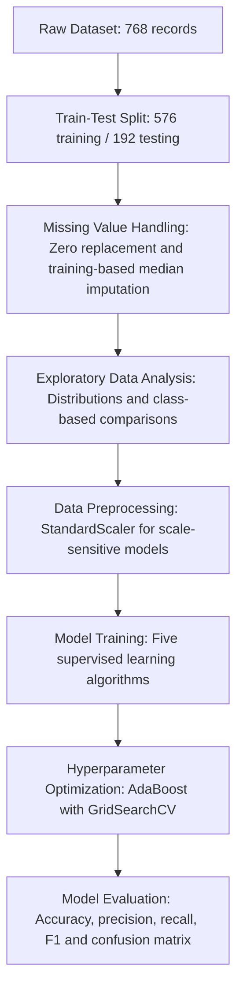

# Diabetes Classification


## Project Overview

A comparative machine learning classification project using the Pima Indians Diabetes dataset. The project focuses on medical data preprocessing, exploratory data analysis, supervised learning, hyperparameter optimization, and classification performance evaluation.

## Dataset

| Attribute | Value |
|---|---:|
| Total records | 768 |
| Input features | 8 |
| Target classes | 2 |

| Feature | Description |
|---|---|
| Pregnancies | Number of pregnancies |
| Glucose | Plasma glucose concentration |
| BloodPressure | Diastolic blood pressure |
| SkinThickness | Skinfold thickness |
| Insulin | Serum insulin |
| BMI | Body mass index |
| DiabetesPedigreeFunction | Family history indicator |
| Age | Age in years |
| Outcome | Binary target (0 or 1) |

## Machine Learning Workflow



## Model Performance

| Model | Test accuracy |
|---|---:|
| **Random Forest** | **78.13%** |
| AdaBoost | 75.00% |
| SVC | 69.79% |
| Logistic Regression | 69.27% |
| KNN | 68.75% |

Reported accuracy on the held-out test set of 192 samples.

Random Forest achieved the highest reported test accuracy among the five evaluated classifiers. SVC achieved higher recall for the positive class, illustrating the trade-off between accuracy and sensitivity.

## Random Forest — Confusion Matrix

| Actual / Predicted | Negative | Positive |
|---|---:|---:|
| Negative | 102 (TN) | 21 (FP) |
| Positive | 21 (FN) | 48 (TP) |

Total: 192 test samples.

## Hyperparameter Optimization

| Parameter | Search space |
|---|---|
| Algorithm | AdaBoost |
| n_estimators | 50, 100, 200, 500 |
| learning_rate | 0.01, 0.1, 0.5, 1.0 |
| CV folds | 5 |
| Total fits | 80 |
| Scoring metric | Recall |

## Technologies

- Python
- Pandas & NumPy
- Scikit-learn
- Matplotlib & Seaborn
- GridSearchCV
- Jupyter Notebook

## Repository Structure

```text
diabetes-classification/
├── AdaboostClassification.ipynb
└── README.md
```

## Getting Started

```bash
git clone https://github.com/blgmstf332/diabetes-classification.git
cd diabetes-classification
pip install pandas numpy scikit-learn matplotlib seaborn jupyter
jupyter notebook
```

Obtain the Pima Indians Diabetes dataset separately and place it at `MachineLearningDataSets/16-diabetes.csv`, or update the dataset path in the notebook.

## Limitations & Future Improvements

- Apply stratified train-test splitting.
- Integrate missing value imputation into cross-validation pipelines.
- Compare models using ROC-AUC, recall, and F1-score.
- Perform systematic hyperparameter optimization across all classifiers.
- Correct the evaluation helper function.
- Add reproducible dependency management and external validation.

**Disclaimer:** This project is intended for educational machine learning research and is not a clinically validated diagnostic tool.

## Author

**Mustafa Kılıç**

Computer Engineering Student — Artificial Intelligence, Machine Learning & Data Science

[GitHub](https://github.com/blgmstf332)
